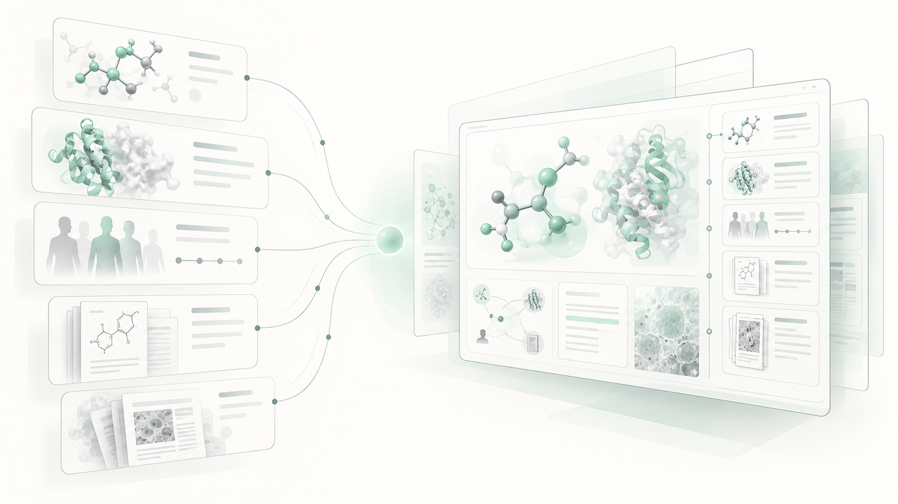

# X-Pharma

**面向研究人员与 Agent 的开源医药情报平台。**

X-Pharma brings pharmaceutical research, source evidence, and governed data into one workbench, with a shared MCP interface for agents.

从药物、靶点到临床试验、专利和交易，在同一个工作台中寻找线索、关联信息并核对证据。研究人员与 Agent 可以围绕相同的数据、来源和权限开展工作。

概念插图，非真实产品界面；图中的结构与研究素材仅用于说明信息关联。

[开始使用](docs/getting-started.md) · [安全](SECURITY.md) · [Apache-2.0](LICENSE)

## 从一个问题开始

### 了解一个药物或靶点

跨领域检索并打开实体档案，查看药物、靶点、临床试验与相关信息。使用结构检索与对比进一步探索候选分子，减少在多个独立来源之间反复拼接线索的工作。

### 追踪研究与市场变化

查询临床、专利、公司和交易信息，结合按需公开调研寻找新的线索。在线著录与本地已治理事实分别呈现，帮助判断哪些信息仍需核实。

### 把结论带回证据

保留来源、版本和原文定位，通过收藏、知识页与受控导出整理研究。团队按组织、角色和数据许可协作，私人研究与其他组织的数据保持隔离。

### 让 Agent 参与研究

通过标准 MCP 接口查询领域数据与证据。人员与 Agent 使用相同的权限边界，查询和导出受身份、数据许可、配额及适用合同约束。

## 让分散的信息成为可用资料

从文件夹、HTTP、S3、SFTP、SMB 和支持的公共来源接入获授权的数据。来源经过扫描、解析与治理审核，再进入检索和研究工作台。

ClinicalTrials.gov 与 ChEMBL 的目标/机制数据支持持续同步。可选 AI 与 OCR 协助处理材料，模型输出经治理审核后才能成为权威数据。

## 开始使用

X-Pharma 支持 Linux x86-64 和 WSL2 Linux 环境。按[快速开始](docs/getting-started.md)启动自己的工作台、创建账号并接入数据；仓库不包含业务数据库、模型或商业数据。

## 使用前须知

当前为开发版本，数据覆盖取决于实际接入且获授权的来源，单次同步不代表全库覆盖。企业部署和真实 AI/OCR 需在目标环境验证；AI 默认关闭，启用第三方服务前需明确确认费用与资料外发权限。

研究与模型输出需要回到来源核实，不能据此宣称药物有效、安全或具备临床适用性。

## 许可证

第一方源码和文档采用 [Apache License 2.0](LICENSE)，署名见 [NOTICE](NOTICE)。第三方库、容器、模型和数据保留各自许可证，见 [第三方声明](THIRD_PARTY_NOTICES.md)。Apache-2.0 不授予第三方医药数据、模型权重或在线服务的访问与再分发权。
